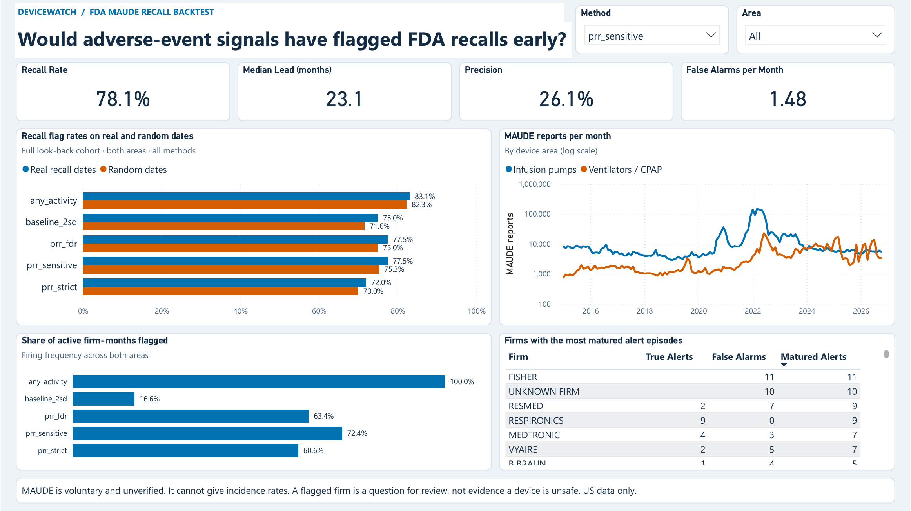
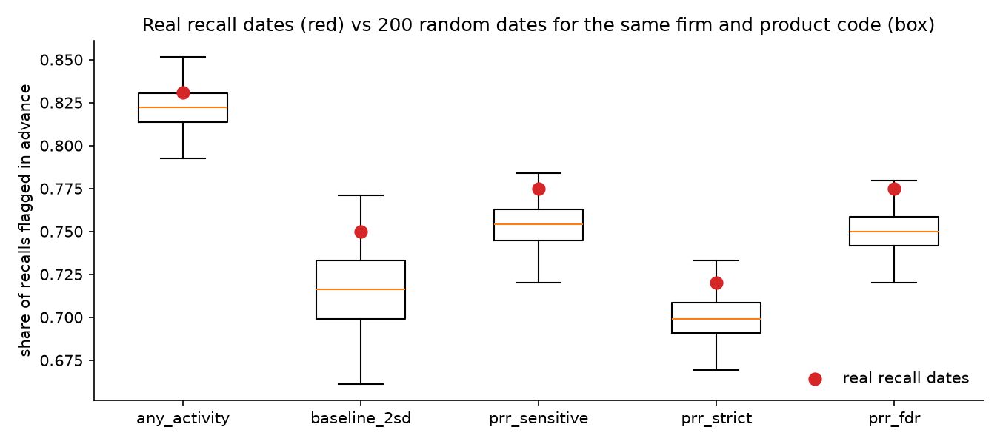
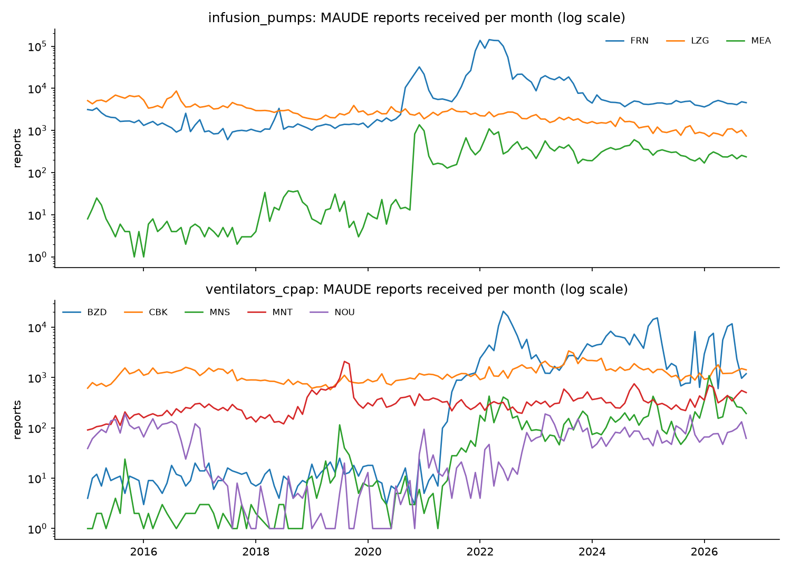

# Project C: DeviceWatch (4-day core) — Would Adverse-Event Signals Have Flagged Recalls Early?

**Status:** Complete: pipeline, 25 passing tests, backtest, null test, report and Power BI dashboard | **Data:** real public data (openFDA MAUDE adverse-event reports and device recalls)
**Relevant to:** medtech post-market surveillance (PMS) / vigilance, regulatory affairs, testing-and-certification
**Earlier plans:** [`README_v1_original.md`](README_v1_original.md), [`README_v2_9day.md`](README_v2_9day.md)



## 1. The one question

> If a safety team had run disproportionality signals every month using only the reports FDA had **received by that month**, how many recalls would it have flagged in advance, how many months early, and how many false alarms would it have raised?

Everything in the project serves this as-of backtest (Q3). The result is reported against a simple baseline; if the signals do not beat it, the report says so.

## Results (full write-up: [`reports/REPORT.md`](reports/REPORT.md))

2,548,521 MAUDE reports (2015-01 to 2026-10), 279 recall events (2017-01 to 2026-10), 2 product areas, 8 product codes.

| Method | Recalls flagged in advance | Median lead (months) | Precision (matured alerts) | False alarms / month | Random-date rate (null) |
|---|---|---|---|---|---|
| PRR/ROR + trend, sensitive | 78.1% | 23.1 | 0.261 | 1.48 | 75.3% (p = 0.080) |
| PRR/ROR + trend, strict | 72.4% | 23.1 | 0.243 | 1.52 | 70.0% (p = 0.110) |
| Baseline: count > 12-month mean + 2 SD | 72.8% | 17.0 | 0.309 | 2.14 | 71.6% (p = 0.095) |
| Reference: every active firm-month | 83.9% | 23.3 | 0.198 | 1.72 | 82.3% |

**Short answer:** the PRR/ROR signals fire in 72% of active firm-months, so they "flag" random dates almost as often as real recall dates. As specified, they do not beat chance timing or the simple 2-SD baseline. The baseline fires in 17% of firm-months and has the best precision. Case study: for the June 2021 Philips Respironics CPAP recall, the strongest signal (DEGRADED, PRR 54.7) fired about 2 weeks before the recall, not months.



*Each box is the share of recalls "flagged in advance" when every recall is moved to 200 random dates (same firm and product code). The red dot is the real recall dates. They are barely above the boxes, which means the signals fire so often that timing carries almost no information.*



*Reporting surges are visible: CareFusion drives the infusion-pump spike (2021-22), and ventilator/CPAP reports rise sharply after the June 2021 Philips recall (stimulated reporting).*

## 2. Scope (2 product areas)

Chosen as the two largest areas on **both** reports and recalls, from live openFDA counts on 2026-11-09. Report counts are `date_received` since 2015; recall counts below are all years (279 recall events fall in the 2017-2026 backtest window).

| Area | Product codes | MAUDE reports since 2015 | Recalls (all years) |
|---|---|---|---|
| Infusion pumps | FRN (general), LZG (insulin), MEA (PCA) | ~2.0M (FRN ~1.6M, LZG ~0.39M) | 721 + 126 + 46 |
| Ventilators / CPAP | CBK, BZD, MNS, NOU, MNT | ~0.6M | 335 + 83 + 21 + 16 + 64 |

Considered and left out: CGMs (QBJ/QLG: millions of reports but only 23 and 10 recalls, too few to validate against), AID insulin pumps (QFG: 24 recalls). Codes are fixed in `config/scope.yaml`.

Known artefact: FRN has about 888k reports received in 2022 against about 60k in a typical year. One manufacturer, CareFusion, files 86.2% of all FRN reports (96.9% between 2020-11 and 2022-07). The data cannot say why. The spike is left in the data, and it is one reason a "compare against other firms" signal behaves badly here (see [`reports/REPORT.md`](reports/REPORT.md) section 2).

## 3. Data

| Source | Used for | Notes |
|---|---|---|
| openFDA device event (MAUDE) | Reports: product code, manufacturer, event type, problem codes, `date_received` | API max 1,000 per call, `skip` capped at 25,000, so pulled in monthly windows (split to half-windows when over cap). Needs a free API key. Bulk files (18.7 GB for all devices) are the fallback only if the API pull is not viable. |
| openFDA device recall | Ground truth: recalling firm, product code, initiation date, root cause (no recall-class field exists in this endpoint) | Product rows are collapsed to recall events by `res_event_number` |
| openFDA device classification | Product code to device name and class | |

## 4. Pipeline (DuckDB SQL: raw → clean → signal)

```
data/raw/            gz JSON from openFDA, one file per product code x month (never edited)
sql/00_macros.sql    norm_firm(), param()
sql/01_raw.sql       load raw JSON into DuckDB raw tables
sql/02_clean.sql     one row per report x in-scope device, dedupe on report number, date checks, problem terms, recall events
sql/03_firms.sql     apply harmonised manufacturer names (src/firms.py: rapidfuzz + config/firm_overrides.csv)
sql/04_signals.sql   as-of monthly 2x2 counts, PRR, ROR, 95% CI, minimum count, Poisson trend, BH-FDR variant
sql/05_baseline.sql  baseline rule (count > 12-month mean + 2 SD) and the always-on reference rule
sql/06_backtest.sql  alert episodes, recall hits, lead time, precision, false alarms per month
sql/07_null.sql      random-date null test (200 dates per recall)
src/                 ingest.py (API), build.py (runs the SQL), firms.py, report.py (exports), powerbi.py
tests/               test_clean.py, test_signals.py, test_backtest.py (25 tests)
reports/             REPORT.md, CSV outputs, figures/, powerbi/
```

### Run it

```powershell
python -m venv .venv; .\.venv\Scripts\Activate.ps1; pip install -r requirements.txt
$env:OPENFDA_API_KEY = "<your key>"     # free: https://open.fda.gov/apis/authentication/
python src\ingest.py all              # about 1 to 2 hours; resumable (cached months are skipped)
python src\build.py                   # rebuilds data/gold/devicewatch.duckdb from data/raw (~1.5 min)
python src\report.py                  # writes reports/*.csv, headline.json, figures
python src\powerbi.py                 # optional: reports/powerbi/
python -m pytest tests -q
```

## 5. Method

- **Comparator:** other manufacturers of the same product code (competitor background). PRR and ROR with 95% CI for manufacturer x problem-code pairs, minimum 3 reports.
- **Trend flag:** Poisson rate test of the last 3 months against the preceding 12 months. A signal fires when disproportionality **and** the trend flag are both met. (CUSUM was not built.) A Benjamini-Hochberg FDR variant was added after the null test and is reported as such.
- **Null test:** each recall's date is replaced by 200 random dates (same firm and product code) to check whether hits come from timing or from firms being flagged all the time.
- **As-of replay:** for each month M from 2017, use only rows with `date_received` ≤ M and recompute. A test asserts no future row is used.
- **Matching to recalls:** recall records are collapsed to recall events (`res_event_number`). The openFDA recall endpoint has no recall-class field, so there is no Class I/II/III split. A hit is a signal for the same firm and product code that fired before the recall initiation date. A false alarm is a signal with no recall for that firm and product code in the next 24 months.
- **Two thresholds** (sensitive and strict) to show the trade-off.
- **Baseline:** flag any firm x product code month with report count above its 12-month mean + 2 SD.

## 6. Power BI dashboard

One page: [`reports/powerbi/DeviceWatch.pbix`](reports/powerbi/DeviceWatch.pbix) (open in Power BI Desktop; data is embedded). The picture at the top of this README is the page. It has a method and area slicer, four KPI cards (recall rate, median lead, precision, false alarms per month), real-vs-random-date bars, monthly report volume, how often each method fires, and the firms with the most matured alerts.

- Tables and DAX measures, with the expected value of every measure: [`reports/powerbi/MEASURES.md`](reports/powerbi/MEASURES.md)
- Build notes: [`reports/powerbi/NOTES.md`](reports/powerbi/NOTES.md)
- The measures were checked against the pipeline's own results (`reports/evaluation.csv`). The cards use all 279 recalls; the real-vs-random chart uses the 236 recalls with a full 24-month look-back, which is the fair cohort for that test. The chart says which it uses.
- Rebuild the CSVs with `python src/powerbi.py`. The dashboard was built with the help of Codex and verified against the expected values.

## 7. Deliverables

- [`reports/REPORT.md`](reports/REPORT.md): findings first, limits up front, evaluation tables, null test, case study, one paragraph on how the output would feed a periodic safety trend report.
- `sql/` pipeline queries, `src/` code, 25 tests, firm-name mapping (`data/clean/firm_map.csv`, `config/firm_overrides.csv`).
- All result tables as CSV in `reports/`, figures in `reports/figures/`, dashboard files in `reports/powerbi/`.
- Raw data (455 MB) and the DuckDB database (645 MB) are **not** in the repository. `python src/ingest.py all` and `python src/build.py` recreate them.

## 8. Checks that pass

- One command (`python src/build.py`) rebuilds everything from raw data in about 1.5 minutes. `python -m pytest tests` gives 25 passed.
- Counts reconcile to the live openFDA API within 30 reports for every product code (`reports/reconciliation.txt`).
- No future data: a test recomputes every statistic on data cut off at a given month and requires identical results. A deliberately injected leak makes it fail.
- Every number in the report and the dashboard comes from a run. The signals do not beat the baseline, and the report says so.

## 9. Limitations (first section of the report)

- MAUDE is voluntary and unverified; FDA says it cannot give incidence rates or show causation.
- No sales or usage denominator; large firms report more simply from market share. Comparing within a product code reduces this but does not remove it, and here one firm files 86% of general infusion-pump reports.
- Reporting rules and behaviour changed over time, and reports spike after recalls and media coverage, so signals after a recall date do not count as early warning.
- Recalls are an imperfect ground truth: some real problems never lead to a recall. Recalls are matched to reports at firm x product-code level only.
- Manufacturer names are harmonised at parent level (for example Covidien into Medtronic), which merges business units.
- **Known issue:** 7,103 reports (0.28%) have no manufacturer name. They are grouped as one pseudo-firm, "UNKNOWN FIRM". It raises alerts that can never match a recall, so it slightly overstates false alarms (for example 10 of the 188 matured alerts for the sensitive rule). It does not change the conclusions. It was left in so that published numbers match the code.
- US data only.

## 10. Do not claim

- That a flagged device or manufacturer is unsafe.
- That this follows FDA's or SFDA's actual signal process. It is a surveillance-style analysis on US public data.

## 11. Future work (parked on purpose)

- Narrative failure-mode classification (keyword tagger, TF-IDF + logistic regression, LLM comparison).
- Streamlit signal-review app and auto-generated monthly signal brief.
- IMDRF code mapping and EU MDR Article 88 / ISO 14971 trend-report formatting.
- A comparator that survives concentration (each firm against its own history), tested on recalls after a fixed cut-off date so it is not tuned on the same recalls.
- An overdispersion-aware trend test (negative binomial) and CUSUM.
- Exclude the "UNKNOWN FIRM" pseudo-firm from alerts.
- Bayesian shrinkage (EBGM/BCPNN).
- GCC regulator notice lag analysis (SFDA/UAE).
- CGMs and AID pumps (needs a recall-poor validation approach).

## 12. Resume bullets

Every number below is in `reports/` (see `REPORT.md`).

> Built a DuckDB SQL pipeline on 2.55M FDA MAUDE adverse-event reports (infusion pumps, ventilators/CPAP) to backtest monthly PRR/ROR safety signals against 279 FDA recalls, using only data available each month (proved by a no-future-data test among 25 pytest tests); counts reconciled to the openFDA API within 30 reports per product code.

> Showed with a random-date null test that signals flagging 78% of recalls in advance (median 23 months) also flagged 75% of random dates (p = 0.08), because they fired in 72% of active firm-months; a simple 2-SD baseline flagged 73% of recalls while firing in 17% of firm-months, at higher precision (0.31 vs 0.26).
